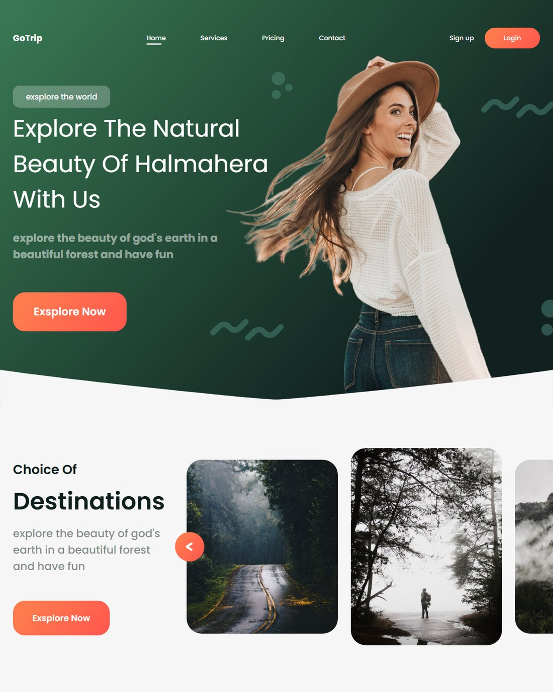
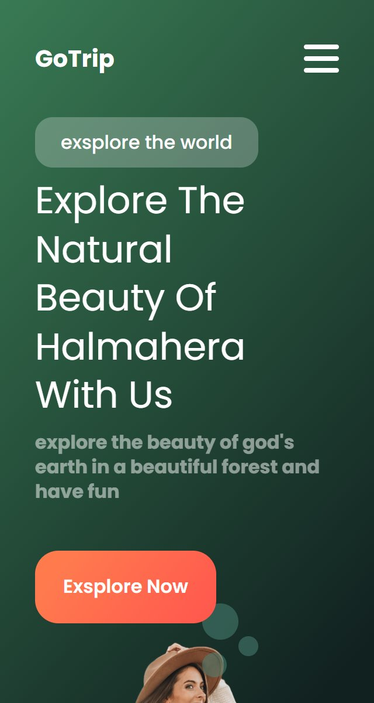

# GoTrip — лендинг турагентства

Адаптивный лендинг турагентства с каруселью направлений, блоком отзывов и формой подписки.

**Демо:** [pavelreb.github.io/GoTrip](https://pavelreb.github.io/GoTrip/)

| Десктоп | Мобильная версия |
|---|---|
|  |  |

## Возможности

- Карусель направлений (Owl Carousel)
- Блок отзывов клиентов с рейтингом
- Форма подписки на рассылку
- Адаптивная вёрстка: корректное отображение от мобильных устройств до широких мониторов
- Бургер-меню на мобильных устройствах

## Стек

HTML5 · CSS3 (Flexbox, медиазапросы) · JavaScript · Owl Carousel

## Запуск локально

Проект не требует сборки — достаточно открыть `index.html` в браузере или запустить любой статический сервер:

```bash
npx serve .
```

---

# GoTrip — Travel Agency Landing Page

Responsive travel agency landing page with a destinations carousel, testimonials and a newsletter form.

**Live demo:** [pavelreb.github.io/GoTrip](https://pavelreb.github.io/GoTrip/)

## Features

- Destinations carousel (Owl Carousel)
- Testimonials section with ratings
- Newsletter subscription form
- Responsive layout from mobile to widescreen
- Mobile burger menu

## Tech stack

HTML5 · CSS3 (Flexbox, media queries) · JavaScript · Owl Carousel

## Run locally

No build step required — open `index.html` in a browser or use any static server:

```bash
npx serve .
```
